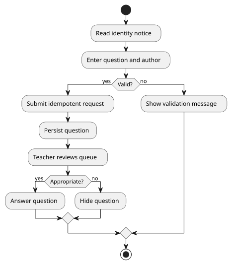
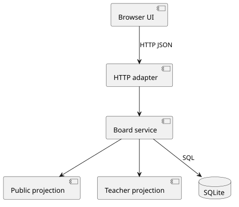
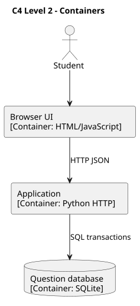
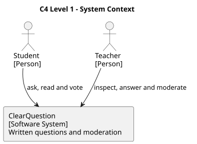
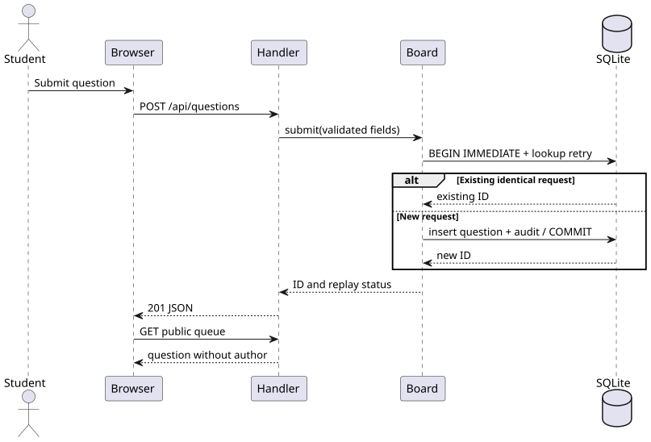
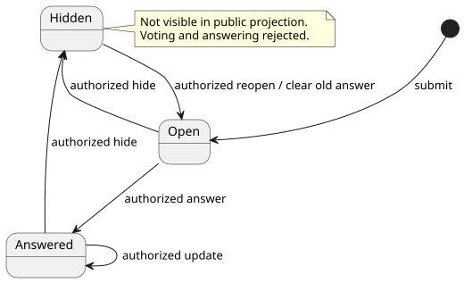
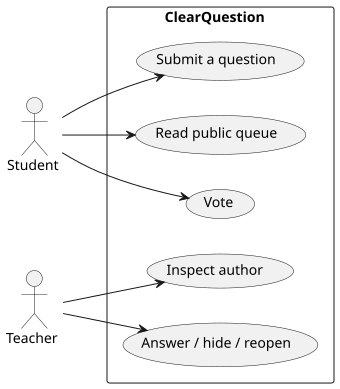

# ClearQuestion classroom question board

**Subject:** Software Architecture  
**Portfolio owner:** Aibyn Samat

This repository contains an executable demonstration, design or research artifacts, automated
checks and reproducible execution reports. It was prepared as new portfolio work in November 2026.

## Run

```sh
python -m venv .venv
# Activate .venv using your platform's normal command.
python -m pip install -r requirements-dev.txt
python app.py
python tools/evidence.py
```

Reports: [execution record](reports/execution.json), [test output](reports/test-output.txt).
[GitHub Actions](https://github.com/aahhaha/aitu-sa-clearquestion-architecture/actions) runs the independent Linux checks.
The report records timestamps, environment, test counts and source hashes.

## Read the portfolio

[docs/SRS.md](docs/SRS.md)  [docs/architecture.md](docs/architecture.md)  [docs/quality-and-atam.md](docs/quality-and-atam.md)  [docs/traceability.md](docs/traceability.md)

[Preparation and attribution](PROVENANCE.md). Do not publish private keys, real student records or raw interview recordings.

## Preserved CI evidence

[Successful verification run](https://github.com/aahhaha/aitu-sa-clearquestion-architecture/actions/runs/43629621781) tested source commit `3a3eb2c87dc7341f096b580b5254932bd99e6b6b`.
[Preserved reports](evidence/43629621781) include machine-readable results and generated artifacts.
The later evidence-only commit does not change the tested implementation.

### Rendered architecture diagrams


**Activity**



**Component**



**Container**



**Context**



**Sequence**



**State**



**Usecase**


