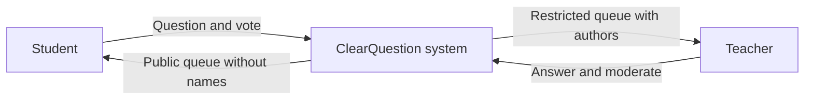
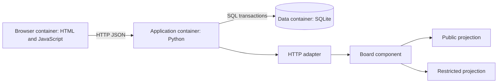
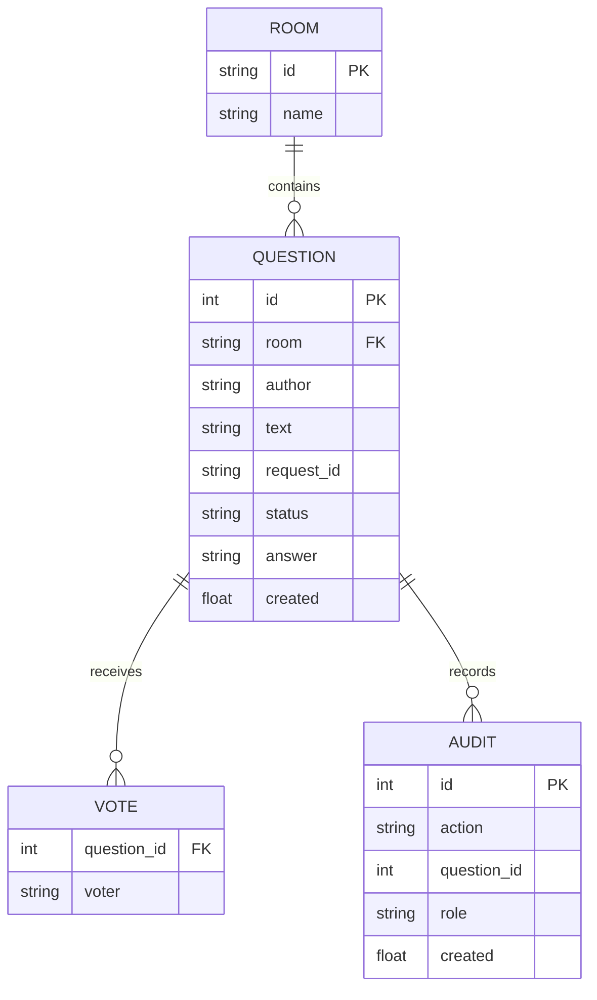

# Architecture and modelling

## Views

C4 levels are represented by context and container diagrams below. The implementation is a
modular monolith: browser UI -> HTTP adapter -> Board domain/storage service -> SQLite.
This keeps privacy projection and database invariants in one transaction boundary. A message
broker and independent services would increase operational work without demonstrated load needs.

For standards-specific diagrams see [PlantUML sources](diagrams/): use case, sequence, component,
activity, state, C4 context and container. CI renders them as SVG artifacts. The BPMN 2.0 XML
[question-process.bpmn](question-process.bpmn) models submission, teacher review and publication.
The process model includes human response work; it is a model, not an automated 15-minute SLA.

## Technology alternatives

| Choice | Alternative | Benefit | Cost / review trigger |
|---|---|---|---|
| SQLite | PostgreSQL | Single-file setup, real constraints, transaction tests | One writer at a time; revisit for multi-instance deployment |
| Modular monolith | Microservices | Simple invariant enforcement and local tests | Limited independent scaling; revisit with measured demand |
| Poll / refresh | WebSockets | Explicit, testable HTTP contract | No push delivery; revisit if live refresh is required |
| Teacher-only identity projection | Fully anonymous storage | Moderation accountability | Teacher can identify authors; notice is required |

## Integration and evolution

Static UI and JSON API share origin. The browser does not receive an administrative key from
server pages; teachers enter a key locally. The prototype stores teacher-visible names in its
protected database, so application-layer separation does not replace filesystem protection.
The ISF repository demonstrates encryption, TLS and segmentation separately. Production
integration would add institutional SSO, HTTPS, operational backups and defined retention.
